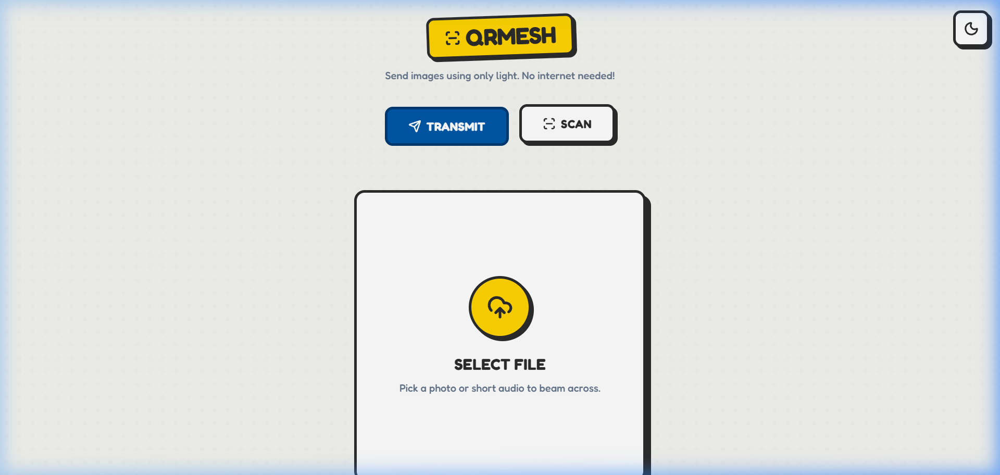
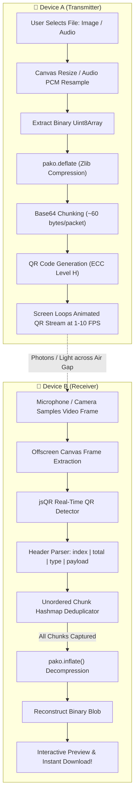

# 🧱 QRMesh — Air-Gapped Optical Data Transfer

<div align="center">



<br />

[](https://qr-filemesh.netlify.app/)
[](https://github.com/hasim2006/QR-Mesh)
[](LICENSE)

<br />

[](https://react.dev/)
[](https://www.typescriptlang.org/)
[](https://vitejs.dev/)
[](https://tailwindcss.com/)
[](https://github.com/nodeca/pako)
[](https://github.com/cozmo/jsQR)
[](#-air-gapped-security--use-cases)

<p align="center">
  <b>Transfer files and media between devices using ONLY LIGHT.</b><br/>
  <i>Zero Wi-Fi. Zero Bluetooth. Zero Cellular. Zero Cables. Pure Visual Photons.</i>
</p>

### 🔗 Public Live URL: [https://qr-filemesh.netlify.app/](https://qr-filemesh.netlify.app/)

</div>

---

## ⚡ Quick Links & Navigation

- [🌐 Live Web App](https://qr-filemesh.netlify.app/)
- [📸 Application Screenshots & UI Showcase](#-application-screenshots--ui-showcase)
- [🌟 What is QRMesh?](#-what-is-qrmesh)
- [🔬 How It Works (Optical Air-Gap Pipeline)](#-how-it-works-optical-air-gap-pipeline)
- [📦 Fountain Code Packetization & Compression](#-fountain-code-packetization--compression)
- [📱 Device-to-Device Testing Walkthrough](#-device-to-device-testing-walkthrough)
- [🛠️ Tech Stack & Architecture](#️-tech-stack--architecture)
- [🚀 Local Setup & Installation](#-local-setup--installation)
- [🛡️ Air-Gapped Security & Use Cases](#-air-gapped-security--use-cases)
- [📄 License & Author](#-license--author)

---

## 📸 Application Screenshots & UI Showcase

<div align="center">

| 📡 Transmit Mode (Optical Stream) | 📷 Scan Mode (Real-Time Camera Decoder) |
| :---: | :---: |
|  |  |
| *File compression, chunking & animated QR code player* | *Live camera viewfinder with real-time packet accumulator* |

| 🌓 Light Mode (Tactile Lego Aesthetic) | 🌑 Dark Mode (Neobrutalism Contrast) |
| :---: | :---: |
|  |  |
| *High-contrast primary palette with interactive stud grid* | *Sleek dark theme optimized for low-light scanning* |

</div>

---

## 🌟 What is QRMesh?

**QRMesh** is an open-source, air-gapped optical data transmission application running 100% in the web browser. It transforms screens into **visual optical transmitters** and device cameras into **high-speed data receivers**.

By converting files (photos, audio notes, text) into compressed binary payloads, splitting them into an animated loop of high-density QR codes (Fountain codes), and reading them with standard camera hardware, QRMesh creates a visual wireless bridge between physically disconnected computers.

> **Why Optical Air-Gap?** Unlike radio frequency signals (Wi-Fi, Bluetooth, NFC), visual light cannot penetrate physical walls, cannot be intercepted by RF spectrum analyzers, and requires zero network handshakes or credentials.

---

## 🔬 How It Works (Optical Air-Gap Pipeline)



### Transmission Pipeline:
1. **Pre-Processing & Compression**:
   - **Images**: Automatically resized on an off-screen canvas to bounded dimensions and compressed to compact JPEG.
   - **Audio**: Downsampled via Web Audio API `OfflineAudioContext` to 8 kHz 8-bit mono PCM.
   - **Binary Deflate**: Compressed using Zlib DEFLATE via `pako` to reduce total payload bytes.
2. **Packet Framing**:
   - Split into uniform ~60-byte chunks with header format: `<chunk_index>|<total_chunks>|<type>|<base64_data>`.
3. **Animated Visual Loop**:
   - High-density QR codes generated with Level H Reed-Solomon error correction and cycled at user-selected FPS (1–10 FPS).
4. **Camera Capture & Reconstruction**:
   - Receiving device's camera captures frames in *any* arbitrary sequence. Missed frames are automatically picked up on the next cycle!
   - Once all unique chunks are collected, `pako.inflate` reconstructs the original file instantly.

---

## 📦 Fountain Code Packetization & Compression

Optical communication is inherently lossy due to camera frame drops and motion blur. QRMesh solves this using **unordered carousel packetization**:

```plaintext
Original File (e.g. Photo, 12 KB)
               │
               ▼  [pako.deflate]
Compressed Buffer (3.2 KB)
               │
               ▼  [Chunking Engine]
Packet Frame Format:
┌───────┬───────┬──────┬──────────────────────────────┐
│ Index │ Total │ Type │ Base64 Encoded Binary Chunk   │
│  003  │  052  │ IMG  │ dGhpcyBpcyBhIHNhbXBsZSB...   │
└───────┴───────┴──────┴──────────────────────────────┘
               │
               ▼
[Receiver collects packets 1, 4, 2, 5... until 100% complete!]
```

- **Resilient to Dropped Frames:** The transmitter continuously loops all chunks. The receiver simply catches whichever frame is in view.
- **Level H Error Correction:** Retains up to **30% redundancy** to handle glare, reflections, and hand jitter.

---

## 📱 Device-to-Device Testing Walkthrough

Follow these steps to perform an optical air-gap file transfer:

### 1. Open the Live Application on Two Separate Devices
Open **[https://qr-filemesh.netlify.app/](https://qr-filemesh.netlify.app/)** on:
- **Device 1 (e.g., Laptop / Tablet / Phone A)**
- **Device 2 (e.g., Smartphone / Laptop B)**

> *Note:* HTTPS is required by mobile browsers to access camera feeds (`getUserMedia`). `qr-filemesh.netlify.app` is served over secure HTTPS.

### 2. Configure Device 1 (Transmitter)
1. On Device 1, click **TRANSMIT**.
2. Select an image (or sample file) to transmit.
3. Review the preview and chunk calculation (e.g. `18 chunks`).
4. Set the transmission speed (default: **3–5 FPS**).
5. Click **START TRANSMISSION** to begin the animated optical stream.

### 3. Configure Device 2 (Receiver)
1. On Device 2, click **SCAN**.
2. Allow camera permissions when prompted.
3. Click **START SCANNER**.
4. Point Device 2's camera directly at Device 1's cycling QR screen.

### 4. Experience the Transfer
- Watch the progress bar advance in real time as chunks are collected.
- As soon as 100% of packets are scanned, the original file is reassembled and displayed with a direct download button!

---

## 🛠️ Tech Stack & Architecture

| Layer | Technologies | Role |
| :--- | :--- | :--- |
| **Frontend Framework** | [React 19](https://react.dev/) | High-performance reactive UI rendering |
| **Language** | [TypeScript 5.8](https://www.typescriptlang.org/) | Type-safe binary buffers & state management |
| **Build Tooling** | [Vite 6](https://vitejs.dev/) | Instant HMR and optimized asset bundling |
| **Styling** | [Tailwind CSS v4](https://tailwindcss.com/) | Tactile Lego Neobrutalism design system |
| **Compression Engine** | [pako](https://github.com/nodeca/pako) | High-speed client-side Zlib/DEFLATE compression |
| **QR Code Generator** | [node-qrcode](https://github.com/soldair/node-qrcode) | Canvas rendering with Level H error correction |
| **Optical Scanner** | [jsQR](https://github.com/cozmo/jsQR) | Real-time JavaScript webcam frame decoder |
| **Icons** | [Lucide React](https://lucide.dev/) | Clean, accessible vector icons |
| **Animations** | [Motion](https://motion.dev/) | Smooth transitions & tactile button states |
| **Deployment** | [Netlify](https://www.netlify.com/) | Edge cloud hosting & instant HTTPS |

---

## 🚀 Local Setup & Installation

### Prerequisites
- [Node.js](https://nodejs.org/) (version 18 or higher)
- `npm`, `pnpm`, or `bun`

### 1. Clone the Repository
```bash
git clone https://github.com/hasim2006/QR-Mesh.git
cd QR-Mesh
```

### 2. Install Dependencies
```bash
npm install
```

### 3. Run Development Server
```bash
npm run dev
```
Open [http://localhost:3000](http://localhost:3000) in your browser.

### 4. Build for Production
```bash
npm run build
npm run preview
```

---

## 🛡️ Air-Gapped Security & Use Cases

- 🔒 **High-Security Facilities:** Transmit cryptographic seeds, private keys, or passwords to machines with disabled networking hardware.
- 📴 **Disaster / Zero-Connectivity Zones:** Exchange maps, emergency guidelines, and medical images when cell towers and power grids are offline.
- ⚡ **No Traces on Infrastructure:** Photons leave no logs on internet routers, ISPs, cellular masts, or remote servers.
- 🚫 **Malware Containment:** Physical visual air gaps prevent automated worms or network-based exploits from propagating.

---

## 📄 License

This project is licensed under the [Apache License 2.0](LICENSE).

---

<div align="center">

<b>Developed with ❤️ by <a href="https://github.com/hasim2006">hasim2006</a></b><br/>
<sub>Powered by Optical Light Streams, React 19, and Vite</sub>

<br/><br/>

[](https://qr-filemesh.netlify.app/)

</div>
