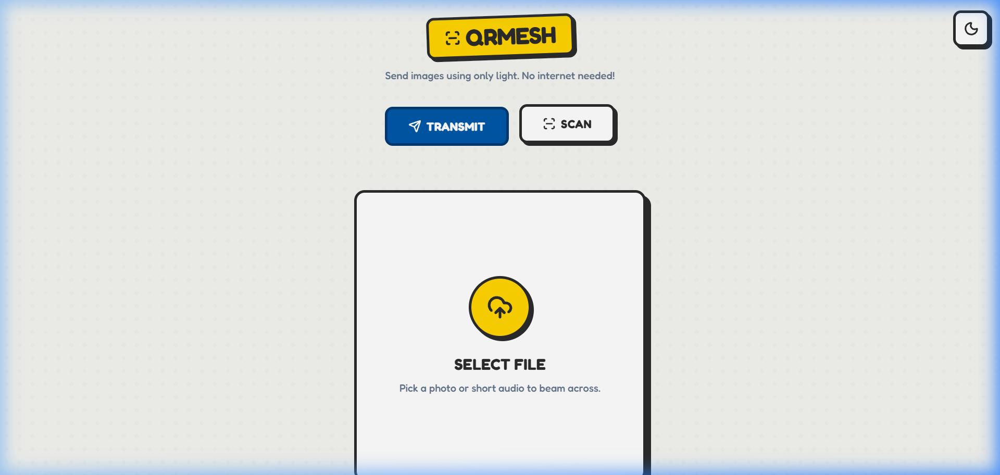
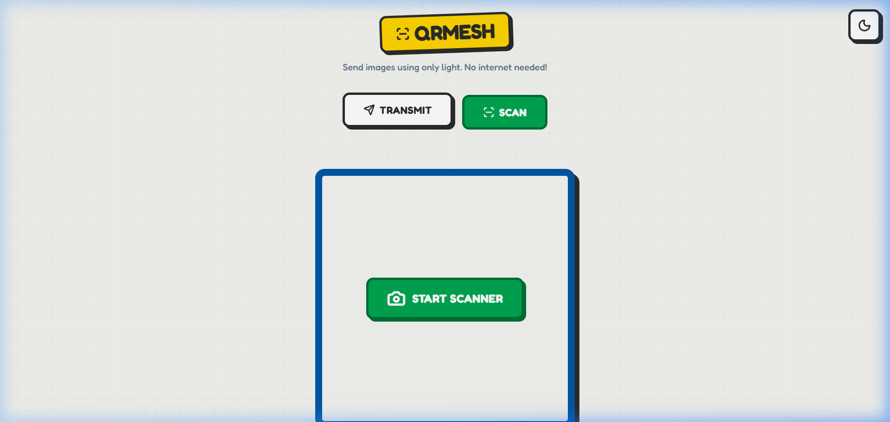
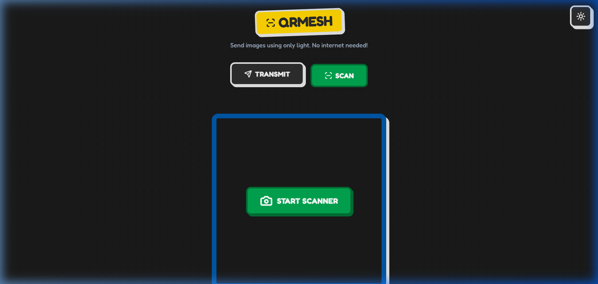
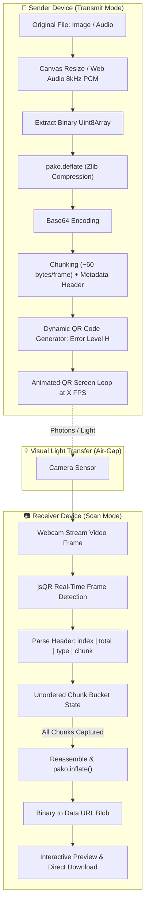

# 🧱 QRMesh

<div align="center">



### **Send files and media using only light — No Internet, Bluetooth, or Wi-Fi required.**

[](https://qr-filemesh.netlify.app/)
[](https://react.dev/)
[](https://www.typescriptlang.org/)
[](https://vitejs.dev/)
[](https://tailwindcss.com/)
[](#-air-gapped-security)
[](LICENSE)

---

[**🌐 Explore Live Application**](https://qr-filemesh.netlify.app/) • [**✨ Features**](#-key-features) • [**⚙️ How It Works**](#-how-it-works) • [**🚀 Quick Start**](#-quick-start) • [**📐 Architecture**](#-architecture--data-pipeline)

</div>

---

## 📖 Overview

**QRMesh** is an experimental, air-gapped optical data transfer system built on top of modern web standards. It enables two devices (phones, tablets, laptops) to transfer files, images, and audio payloads **strictly through visual light**, eliminating the need for Internet access, local Wi-Fi networks, Bluetooth pairing, or intermediate servers.

By converting binary file data into an optimized, compressed stream of cycling high-density QR codes (animated optical pipeline) and scanning them through a device camera in real-time, QRMesh creates a visual wireless bridge between air-gapped computers.

---

## 📸 Screenshots & UI Showcase

| 📡 Transmit Mode (Air-Gapped Optical Stream) | 📷 Scan Mode (Real-Time Camera Decoder) |
|:---:|:---:|
|  |  |

| 🌓 Dark Mode (Lego Neobrutalism Aesthetics) |
|:---:|
|  |

---

## ✨ Key Features

- **⚡ 100% Air-Gapped & Offline**: Zero network traffic. Data travels solely as photons between one screen and another device's camera.
- **🖼️ Multi-Format Support**:
  - **Images**: Automatically compressed, downscaled, and encoded into ultra-compact JPEG streams.
  - **Audio**: Downsampled to 8kHz mono 8-bit PCM WAV streams using Web Audio API for fast visual acoustic transfer.
- **📦 High-Efficiency Compression**: Utilizes **Zlib / DEFLATE** (`pako`) compression to shrink payload sizes before chunking.
- **🔄 Out-of-Order Reassembly**: Chunks are tagged with sequence indexes and total count headers (`index|total|type|data`). The receiving camera captures frames in *any* arbitrary sequence without dropping data.
- **🎛️ Dynamic FPS Control**: Adjust the transmission speed (1 to 10 FPS) to balance speed and camera scanning reliability.
- **🛡️ Error Correction Level 'H'**: Built with Level H Reed-Solomon QR error correction to withstand glare, camera motion blur, and ambient lighting variations.
- **🧱 Tactile LEGO Neobrutalism Theme**: Playful high-contrast design with tactile borders, responsive drop shadows, interactive stud grids, and complete Dark / Light theme support.
- **🔒 Zero-Knowledge & Client-Side**: All decoding, compression, and rendering occur entirely in browser memory (`ArrayBuffer` & `Canvas`). No server storage or third-party telemetry.

---

## 📐 Architecture & Data Pipeline



---

## ⚙️ How It Works

### 1. Transmission Phase (Sender)
1. **File Ingestion**: The user uploads a photo or audio file.
2. **Pre-Processing**:
   - Images are normalized and scaled to a maximum bounded canvas resolution (`150x150`) at 20% JPEG quality.
   - Audio is resampled via an `OfflineAudioContext` down to 8,000 Hz 8-bit mono PCM.
3. **Deflate Compression**: Binary buffers are compressed using `pako.deflate`, drastically reducing the total byte footprint.
4. **Packetization**: The compressed buffer is split into ~60-byte payload chunks with standard metadata:
   ```text
   <chunk_index>|<total_chunks>|<type_flag>|<base64_payload>
   ```
5. **Optical Loop**: The application loops through QR frames at a configurable frequency (default 3 FPS).

### 2. Optical Reception Phase (Receiver)
1. **Camera Feed**: Accesses the device camera using `navigator.mediaDevices.getUserMedia` (`facingMode: 'environment'`).
2. **Frame Scanning**: Video frames are painted onto an offscreen canvas at high frequency, evaluated by `jsQR`.
3. **De-duplication & Tracking**: Captured chunks are stored in a key-value map by index, ensuring duplicates are ignored and missed frames are captured on the next cycle.
4. **Reassembly**: Once all `N` unique chunks are received, the stream is inflated via `pako.inflate` and reconstructed into a previewable data URL for instant download.

---

## 🛠️ Technology Stack

| Technology | Purpose |
|:---|:---|
| **[React 19](https://react.dev/)** | Reactive UI and component lifecycle management |
| **[TypeScript](https://www.typescriptlang.org/)** | Type safety across binary buffers and state pipelines |
| **[Vite 6](https://vitejs.dev/)** | Ultra-fast build tool and development server |
| **[Tailwind CSS v4](https://tailwindcss.com/)** | Neobrutalist design tokens and dark mode styling |
| **[jsQR](https://github.com/cozmo/jsQR)** | High-performance, pure JavaScript QR code scanner |
| **[qrcode](https://github.com/soldair/node-qrcode)** | Canvas & data-URL QR code generator with Level H ECC |
| **[pako](https://github.com/nodeca/pako)** | Fast zlib/DEFLATE compression and decompression |
| **[Lucide React](https://lucide.dev/)** | Clean, accessible iconography |
| **[Motion](https://motion.dev/)** | Fluid micro-animations and state transitions |

---

## 🚀 Quick Start

### Prerequisites
- **Node.js**: v18.0.0 or higher
- **npm** or **bun** / **pnpm** / **yarn**

### 1. Clone the Repository
```bash
git clone https://github.com/hasim2006/QR-Mesh.git
cd QR-Mesh
```

### 2. Install Dependencies
```bash
npm install
```

### 3. Start Development Server
```bash
npm run dev
```
Open your browser at `http://localhost:3000` to run the app locally.

### 4. Build for Production
```bash
npm run build
```
The compiled, production-ready static assets will be output to the `dist/` directory.

---

## 📱 Testing Between Two Devices

To test the full optical air-gap data transmission:

1. Open **[https://qr-filemesh.netlify.app/](https://qr-filemesh.netlify.app/)** on **Device A** (e.g., your laptop or phone).
2. Open the same link on **Device B** (e.g., a second phone or tablet).
3. On **Device A**: Select **Transmit**, upload a picture, and click **Start Transmission**.
4. On **Device B**: Select **Scan**, click **Start Scanner**, and point the camera at Device A's screen.
5. Watch the real-time progress bar fill as the optical packets are captured. Once complete, the image or audio instantly renders for download!

> **Camera Note**: Mobile browsers require an **HTTPS** context or `localhost` to grant camera permissions. Use the deployed Netlify URL for seamless mobile testing.

---

## 📂 Project Structure

```text
QR-Mesh/
├── docs/
│   └── images/
│       ├── qrmesh-transmit.png     # Transmit mode screenshot
│       ├── qrmesh-scan.png         # Scan mode screenshot
│       └── qrmesh-dark.png         # Dark mode screenshot
├── public/                         # Static assets and icons
├── src/
│   ├── components/
│   │   ├── SendMode.tsx            # File upload, chunking & QR stream player
│   │   └── ReceiveMode.tsx         # Camera scanner, chunk accumulator & decoder
│   ├── utils/
│   │   ├── cn.ts                   # Class name merger helper
│   │   └── dataUtils.ts            # Compression, PCM audio & chunking algorithms
│   ├── App.tsx                     # Main layout & theme controller
│   ├── index.css                   # Lego neobrutalism variables & styling
│   ├── main.tsx                    # React application entrypoint
│   └── types.ts                    # Global TypeScript interfaces
├── index.html                      # HTML template
├── netlify.toml                    # Netlify deployment configuration
├── package.json                    # Project dependencies and scripts
├── tsconfig.json                   # TypeScript compiler configuration
├── vite.config.ts                  # Vite build settings
└── README.md                       # Documentation
```

---

## 🔒 Air-Gapped Security & Use Cases

- **Secure Facilities**: Transmit authentication tokens, credentials, or diagrams in high-security, network-isolated environments where USB drives and wireless signals are restricted.
- **Emergency / Field Operations**: Peer-to-peer data sharing during network blackouts, disasters, or remote locations without cellular reception.
- **Zero-Footprint Communication**: Leave no logs on routers, DNS servers, cell towers, or cloud providers.

---

## 🤝 Contributing

Contributions, issues, and feature requests are welcome!
Feel free to check the [issues page](https://github.com/hasim2006/QR-Mesh/issues).

1. Fork the Project
2. Create your Feature Branch (`git checkout -b feature/AmazingFeature`)
3. Commit your Changes (`git commit -m 'Add some AmazingFeature'`)
4. Push to the Branch (`git push origin feature/AmazingFeature`)
5. Open a Pull Request

---

## 📄 License

This project is open-source and available under the [Apache License 2.0](LICENSE).

<div align="center">
  <sub>Built with ❤️ using React, Vite, and Optical Light Streams</sub>
</div>
